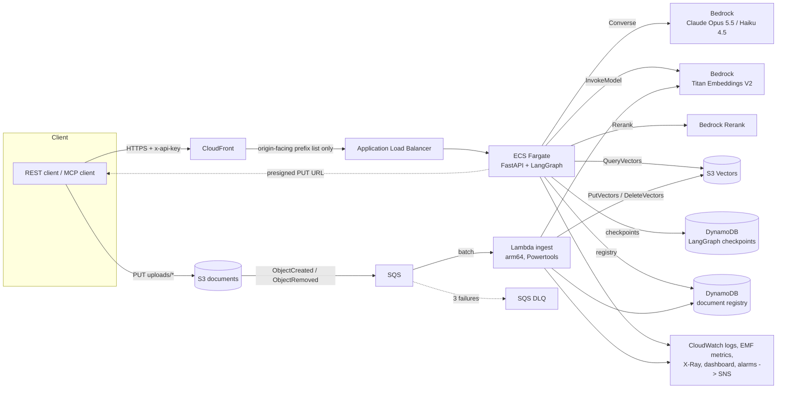
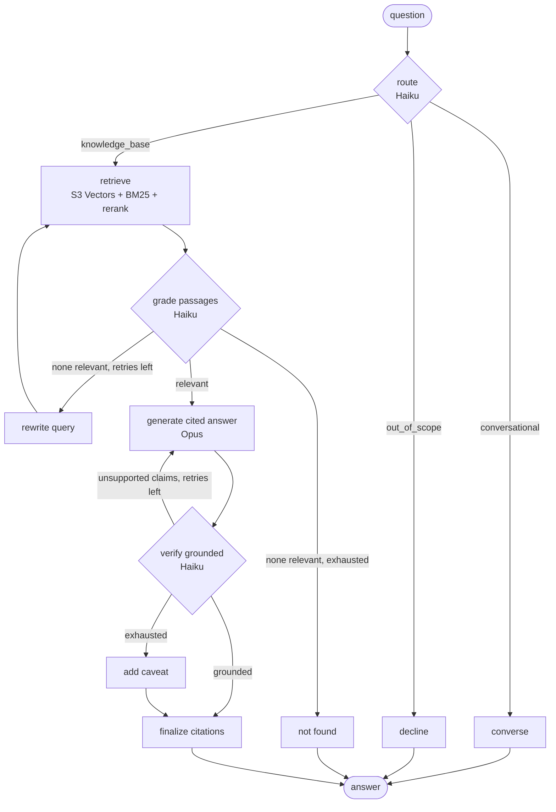

# bedrock-agentic-rag

A self-correcting agentic RAG service on AWS. A LangGraph agent running on **Amazon Bedrock** answers questions over a document corpus with citations. It grades its own retrieval, rewrites queries that miss, and checks its answers for groundedness before returning them. Ingestion is event-driven and serverless; the API runs on **ECS Fargate** behind **CloudFront**. Everything is defined in **AWS CDK**, and every deploy is gated by an evaluation suite.

The sample corpus is a synthetic employee handbook for a fictional company, "Northwind Cloud" (`data/corpus/`). Upload any Markdown, text or PDF files to use your own documents.



## AWS services and what each one does

| Service | Role in the system |
|---|---|
| **Amazon Bedrock** | Claude Opus 5.5 writes cited answers; Claude Haiku 4.5 routes, grades retrieval and verifies groundedness; Titan Text Embeddings V2 (1024-d) embeds chunks and queries; Bedrock Rerank (Amazon Rerank 1.0) re-orders candidates |
| **Amazon S3 Vectors** | Serverless vector index (cosine, float32). Chunk text is stored as non-filterable metadata, so a query returns the passages directly |
| **Amazon S3** | Versioned, private, TLS-only document bucket. Clients upload through presigned URLs, so files never pass through the API |
| **Amazon SQS** | Buffers S3 events for ingestion. A dead-letter queue catches documents that fail three times |
| **AWS Lambda** | Ingestion worker (arm64): extract, chunk, embed, upsert. Idempotent by content hash; Powertools partial batch responses; reserved concurrency caps Bedrock traffic |
| **Amazon ECS on Fargate** | Runs the FastAPI + LangGraph API: auto-scaling on CPU and request count, deployment circuit breaker with automatic rollback |
| **Elastic Load Balancing + CloudFront** | HTTPS at the edge. The ALB only accepts traffic from CloudFront's managed origin-facing prefix list |
| **Amazon DynamoDB** | LangGraph checkpoints (`langgraph-checkpoint-aws` DynamoDBSaver, TTL-expired) for multi-turn memory, plus a document registry |
| **AWS Secrets Manager** | API key, cached by the service so it can be rotated without a redeploy |
| **Amazon CloudWatch, AWS X-Ray, Amazon SNS** | JSON logs, EMF metrics (turn latency, grounded rate, chunks indexed), Lambda tracing, a dashboard, and five alarms published to SNS |
| **AWS IAM + GitHub OIDC** | Least-privilege task and function roles; CI/CD assumes a role through OIDC, so no long-lived AWS keys are stored in GitHub |
| **AWS CDK** | All of the above as Python infrastructure as code, with template assertions in the test suite |

## The agent

`src/agentic_rag/agent/graph.py` is a LangGraph `StateGraph` with checkpointed conversation memory:



- **Routing and memory.** The router condenses follow-up questions into standalone queries using the thread history, which the DynamoDB checkpointer stores per `thread_id`.
- **Corrective retrieval.** Retrieved passages are graded. When none are relevant, the query is rewritten up to twice before the agent says it could not find the answer, instead of guessing.
- **Self-verification.** A judge model checks every claim against the cited passages. Unsupported claims go back to the generator as feedback. If the answer still fails after the retry budget, it is returned with an explicit caveat and `grounded: false`.
- **Testable by design.** The graph depends on two small protocols (`Judge`, `Generator`), so every branch is unit-tested with deterministic fakes (`tests/test_graph.py`).

Retrieval (`src/agentic_rag/retrieval.py`) runs in two stages. Dense recall of 24 candidates comes from S3 Vectors, and BM25 lexical scores over those candidates are fused with Reciprocal Rank Fusion. The top candidates are then re-ordered by Bedrock Rerank. The lexical stage keeps exact terms such as "SEV1", "$400" or policy names from being lost in embedding space.

## Evaluation and CI/CD

`evals/run_evals.py` runs against a 20-question golden set (`evals/golden.jsonl`) covering factual, multi-hop, not-in-corpus and out-of-scope questions. It runs in two modes:

| Mode | When | Metrics (thresholds in `evals/thresholds.json`) |
|---|---|---|
| `offline` | every PR, no AWS | retrieval hit@5 and MRR of the fusion pipeline (current baseline: 1.00 / 0.94) |
| `live` | after every deploy | cited-source hit rate, fact recall, abstention accuracy, grounded rate, p95 latency |

GitHub Actions:

- **`ci.yml`**: ruff, 38 tests (unit, moto-backed integration, CDK template assertions) with an 80% coverage floor, the offline eval gate, Lambda packaging, `cdk synth`, and a Docker build with a container smoke test.
- **`deploy.yml`**: after CI passes on `main`, assumes the deploy role via OIDC, runs `cdk deploy` (which builds and pushes the image and packages the Lambda), seeds the corpus, and runs the live eval gate. Reports are uploaded as artifacts.

## Run it locally

```bash
make install        # uv venv + editable install with dev extras
make test           # 38 tests, no AWS needed
make eval           # offline retrieval eval gate
make synth          # build the Lambda package and synthesize CloudFormation
```

## Deploy to your AWS account

Prerequisites: AWS credentials for the target account, Node.js 20+, `uv`, Docker (CDK builds the API image), and Bedrock model access in the region (default `us-west-2`) for Claude Opus 5.5, Claude Haiku 4.5, Titan Text Embeddings V2 and Amazon Rerank 1.0.

```bash
export CDK_DEFAULT_ACCOUNT=$(aws sts get-caller-identity --query Account --output text)
export CDK_DEFAULT_REGION=us-west-2
make bootstrap      # once per account/region
make deploy         # roughly 10 minutes on the first run
make seed           # upload the sample handbook and wait until it is indexed
make eval-live      # run the live eval gate against the deployment
```

Ask a question:

```bash
python scripts/ops.py ask "How long does a break-glass production session last?"
```

Or call the API directly:

```bash
curl -s "$API_URL/v1/chat" -H "x-api-key: $API_KEY" -H 'content-type: application/json' \
  -d '{"question": "What is the international meal limit?"}'
```

Model IDs are CDK context values in `cdk.json` (`answerModelId`, `judgeModelId`, `rerankModelId`). Override them with `-c answerModelId=...`, for example to use a cross-region inference profile ID.

To enable continuous deployment from GitHub, deploy the OIDC role once (`npx aws-cdk@2 deploy AgenticRagGithubOidc`). Then set the repository secret `AWS_DEPLOY_ROLE_ARN` to its `DeployRoleArn` output and the repository variable `AWS_DEPLOY_ENABLED=true`.

Tear down: `make destroy`. Buckets, tables and logs are configured to be deleted with the stack.

### Cost

Idle cost is dominated by one Fargate task (1 vCPU / 2 GB) and the ALB: roughly $55–70 a month in us-west-2, plus small amounts for CloudWatch, Secrets Manager and Container Insights. S3 Vectors, DynamoDB, Lambda and SQS are pay-per-request and cost cents at demo volume. Bedrock is billed per token; see [Bedrock pricing](https://aws.amazon.com/bedrock/pricing/). Destroy the stack when you're not using it.

## API

| Method | Path | Purpose |
|---|---|---|
| `POST` | `/v1/chat` | `{question, thread_id?}` returns `{answer, citations[], route, grounded, thread_id, latency_ms, trace[]}` |
| `POST` | `/v1/search` | `{query, k}` returns ranked passages (useful for debugging retrieval) |
| `POST` | `/v1/documents/upload-url` | presigned S3 PUT URL under `uploads/`; ingestion starts automatically |
| `GET` | `/v1/documents` | indexed documents from the registry |
| `DELETE` | `/v1/documents/{doc_id}` | deletes the object; the `ObjectRemoved` event removes its vectors |
| `GET` | `/healthz` | health check (no auth) |

All `/v1` routes require the `x-api-key` header; the value is in Secrets Manager under `agentic-rag/api-key`.

### MCP

`src/agentic_rag/mcp_server.py` exposes `ask` and `search_handbook` as MCP tools for Claude Desktop, Claude Code or any MCP client:

```json
{
  "mcpServers": {
    "northwind-handbook": {
      "command": "python",
      "args": ["-m", "agentic_rag.mcp_server"],
      "env": { "AGENTIC_RAG_URL": "https://dxxxx.cloudfront.net", "AGENTIC_RAG_API_KEY": "..." }
    }
  }
}
```

## Layout

```
src/agentic_rag/
  agent/          LangGraph graph, prompts, Bedrock judge/generator
  api/            FastAPI app and API-key auth
  ingest/         Lambda handler and ingestion pipeline
  retrieval.py    dense + BM25 fusion + Bedrock Rerank
  vectorstore.py  S3 Vectors client (and in-memory twin for tests)
  embeddings.py   Titan V2 embedder (and hashing embedder for offline runs)
  documents.py    DynamoDB document registry
  mcp_server.py   MCP server over the REST API
infra/            CDK app: application stack and GitHub OIDC stack
evals/            golden set, thresholds, eval runner
tests/            unit, integration (moto) and CDK assertion tests
data/corpus/      synthetic sample handbook
```

## Design decisions

- **S3 Vectors over OpenSearch Serverless.** For a corpus of this size it removes the always-on OCU cost (OpenSearch Serverless has a minimum monthly charge) and needs no cluster to operate. The `VectorStore` protocol keeps the backend swappable.
- **Two models.** The expensive model only writes the answer; routing, grading and verification are short structured calls on a fast model, which keeps cost and latency down without lowering answer quality.
- **Lambda for ingestion, Fargate for the API.** Ingestion is bursty and event-driven, which suits Lambda behind SQS. Agent turns can take tens of seconds, hold a warm LangGraph and client pool, and benefit from a long-lived process.
- **Fail closed.** The agent says it cannot find an answer rather than guessing, and unverified answers are flagged, not hidden. Both behaviours are measured by the live eval.

## Limitations and next steps

- Streaming responses (SSE) are not implemented yet; `/v1/chat` returns when the turn completes.
- CloudFront's default 60-second origin timeout bounds the longest agent turn; raise the quota or stream responses for longer runs.
- Authentication is a single API key. Production multi-tenant use would put Cognito or an IdP in front of it and add per-tenant metadata filters, which S3 Vectors supports.
- The lexical stage re-scores dense candidates; it does not add recall beyond them. A separate BM25 index would make retrieval fully hybrid.

## License

MIT
